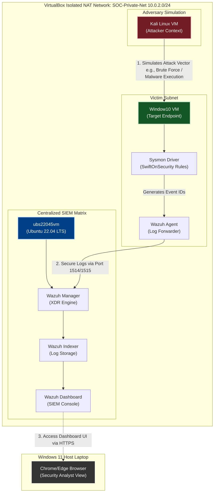

# Enterprise Telemetry Aggregation & Adversary Simulation Lab

## 📌 Executive Summary
This project showcases the implementation of an isolated, multi-node Security Operations Center (SOC) home lab environment running entirely on a Windows 11 host using Oracle VirtualBox. The project establishes an enterprise-grade detection engineering pipeline by isolating target systems, installing low-level kernel monitoring via Microsoft Sysmon, aggregating security telemetry into a centralized open-source SIEM platform (Wazuh), and evaluating coverage by launching adversary simulation frameworks.

---

## 🏗️ Lab Architecture & Network Topology

The entire lab is contained within a private, software-defined VirtualBox NAT network (`SOC-Private-Net`) using the `10.0.2.0/24` subnet. This architecture ensures all attack vectors, command-and-control loops, and explosive payloads remain securely sandboxed away from the physical home network infrastructure.



---

## 🛠️ System Inventory & Provisioning Profiles

| Component | Virtual Instance | Operating System | Operational Role |
| :--- | :--- | :--- | :--- |
| **SIEM Core** | `ubs22045vm` | Ubuntu 22.04 LTS | Log Indexing, XDR Rule Engine, Dashboard Interface |
| **Victim Node** | `Window10` | Windows 10 Enterprise | High-fidelity logging source running Sysmon & Wazuh Agent |
| **Adversary** | `Kali Linux` | Kali Linux | Attack platform executing scanners and payload delivery |

---

## 🚀 Step-by-Step Deployment Logs

### Phase 1: Virtual Network Isolation
1. Configured an internal VirtualBox network infrastructure (`SOC-Private-Net`).
2. Configured all 3 instances to interface over the private virtual network card (`Adapter 1` -> `NAT Network`).
3. Verified end-to-end routing using private ICMP echoing across subnets.

### Phase 2: Orchestrating the Wazuh Matrix
Deployed a production-ready single-node Wazuh cluster on the `ubs22045vm` node by pulling down the comprehensive automation package:
```bash
curl -sO https://wazuh.com && sudo bash wazuh-install.sh -a
```

### Phase 3: Hardening Target Telemetry (`Window10`)
1. Deployed Microsoft Sysmon to intercept deeper kernel actions via the command line.
2. Interfaced Sysmon with the industry-standard `SwiftOnSecurity` configuration template to capture core system actions (Process creation, raw network connections, alternate data streams).
3. Registered the remote Windows endpoint to the central SIEM Manager using secure endpoints over TCP ports `1514`/`1515`.

---

## 🛡️ Active Threat Analysis Write-up & Verification

### Test Case: Detecting MITRE ATT&CK T1110 (Brute Force Attack)
* **Objective:** Simulate a malicious, script-based authentication bypass attempt and verify metric detection coverage inside the SIEM dashboard.
* **Execution (Kali Linux Node):** Executed a targeted password spraying attack against the target `Window10` profile over open administrative network services.
* **Telemetry Analysis:** The SIEM system immediately registered multiple sequential high-severity anomalies mapping to Windows Security Event ID **4625** (An account failed to log on).
* **Defensive Correlation:** Custom alerting metrics successfully surfaced the rogue internal IP address, triggering automated triage metrics on the manager dashboard.

